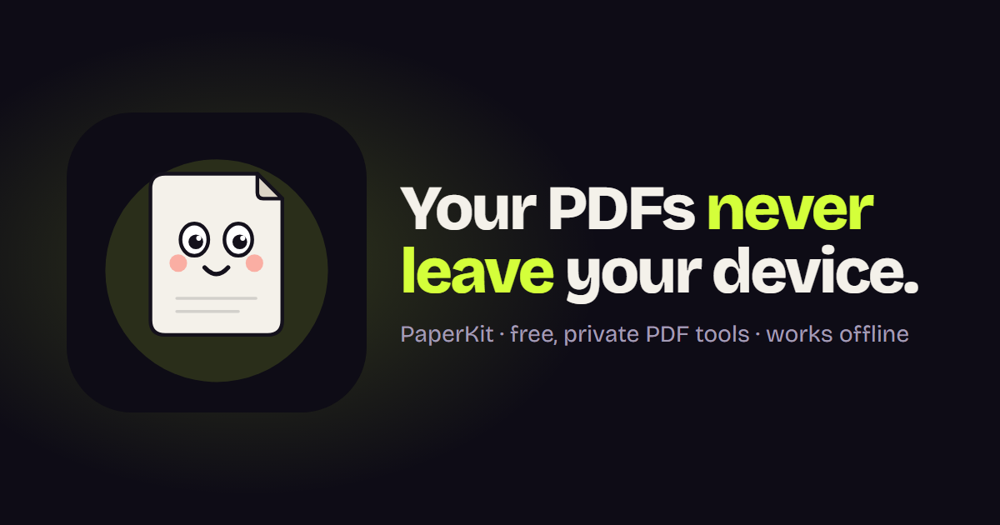

<p align="center">
  
</p>

<h1 align="center">PaperKit 📄👀</h1>
<p align="center"><b>Free PDF tools that never upload your files.</b><br>
Merge, compress, sign, lock, OCR and exam-ready photos, all done inside your browser by a tiny paper buddy called <b>Kit</b>.</p>

<p align="center">
  <a href="https://paperkit-app.pages.dev"></a>
  <a href="https://deploy.workers.cloudflare.com/?url=https://github.com/MrWhiteHat-coder/paperkit"></a>
  <a href="https://codespaces.new/MrWhiteHat-coder/paperkit"></a>
</p>

---

## Why PaperKit?

Most "free PDF" websites upload your Aadhaar, marksheets and bank statements to their servers. PaperKit doesn't.

| | |
|---|---|
| 🫣 **Your file never leaves your device** | Every job runs inside your browser tab. 0 KB uploaded. Turn on airplane mode and try it. |
| 💸 **Actually free** | No "3 tasks left today", no watermark, no sign-up, no ads, no file-size limit. |
| 🎓 **Exam mode** | Photo, signature and documents at the exact size and KB your exam form asks for. |
| ✈️ **Works offline** | Install it once and use it with no internet: exam centre, college, train. |
| ⭐ **Open source** | Read every line. The code is the proof. |

---

## Open it in one tap

| Where | How |
|---|---|
| 🌐 **Any browser** | Go to **[paperkit-app.pages.dev](https://paperkit-app.pages.dev)**. That's it. |
| 🔗 **Straight to a tool** | Every tool has its own link: [`/merge`](https://paperkit-app.pages.dev/merge) · [`/compress`](https://paperkit-app.pages.dev/compress) · [`/exam`](https://paperkit-app.pages.dev/exam) · [`/sign`](https://paperkit-app.pages.dev/sign) … |
| 📲 **Android** | Open the site → tap **Install PaperKit** (or menu ⋮ → *Install app*). Now you can **Share → PaperKit** from WhatsApp, Files or Gmail. |
| 🍎 **iPhone / iPad** | Open in Safari → **Share ⬆ → Add to Home Screen**. |
| 💻 **Windows / Mac (Chrome or Edge)** | Click the install icon in the address bar. After that you can right-click a PDF → **Open with → PaperKit**. |

---

## Run it on your own computer (100% local)

**Windows** (paste in PowerShell):
```powershell
irm https://raw.githubusercontent.com/MrWhiteHat-coder/paperkit/main/install.ps1 | iex
```
It downloads PaperKit into `%LOCALAPPDATA%\PaperKit`, adds a **PaperKit** shortcut to your Desktop, and opens it in your browser. Nothing else to install.

**Mac / Linux** (paste in Terminal, needs Python 3 or Node.js):
```sh
curl -fsSL https://raw.githubusercontent.com/MrWhiteHat-coder/paperkit/main/install.sh | sh
```

**Already cloned the repo?**
```sh
npx serve -s public            # any OS with Node.js
powershell -ExecutionPolicy Bypass -File serve.ps1   # Windows, no Node needed
```

> Curious what the scripts do before running them? Read [`install.ps1`](install.ps1) and [`install.sh`](install.sh). They're short.

---

## Every tool, explained simply

### 🎓 Exam mode (only in PaperKit)
- **Photo / signature / thumb / declaration**: type the rules from your notification (width, height, min KB, max KB). Kit crops, resizes and finds the exact JPG quality to land inside the KB range, then shows ✓ checks.
- **Name & date strip**: adds a white strip with your name and today's date under the photo, for forms that ask for it.
- **Clean paper**: turns a phone photo of your signature into white paper + dark ink.
- **Documents → one PDF**: merges certificates (PDFs or photos) and squeezes them under the KB limit.

> Exam rules change every year, so PaperKit has no made-up presets. Always copy the numbers from your official notification. The **"Where are the rules?"** card shows how to find them in a minute.

### 🧩 Arrange pages
| Tool | What it does |
|---|---|
| 🧷 **Merge** | Join many PDFs (and photos) into one. Drag to set the order. |
| ✂️ **Split & extract** | Keep only the pages you pick, remove pages, split every page apart, or cut by ranges like `1-3, 5, 8-end`. |
| 🧩 **Organize pages** | See every page as a card. Drag to reorder, ⟳ rotate, ✕ delete. |
| 🔄 **Rotate** | Fix sideways or upside-down pages: all of them, or just the ones you tap. |

### 🗜️ Shrink & convert
| Tool | What it does |
|---|---|
| 🗜️ **Compress** | *Light*: perfect quality, text stays selectable. *Balanced*: much smaller. *Strong*: smallest, for strict upload limits. If the file can't get smaller, Kit keeps the original. |
| 🖼️ **Images → PDF** | JPG, PNG, WebP and iPhone HEIC photos into one PDF. A4, Letter or same-as-photo. |
| 📷 **Scan to PDF** | Snap pages with your phone camera. *Scanner look* whitens the paper and darkens the text. |
| 🖼 **PDF → Images** | Every page as JPG or PNG. Many pages come as one ZIP. |
| 🔎 **OCR** | Scanned pages or photos → searchable PDF + text you can copy. **English, Tamil, Hindi**. The first time, Kit downloads the language data once; your file is never sent anywhere. |

### ✍️ Sign & mark
| Tool | What it does |
|---|---|
| ✍️ **Sign** | Draw your signature (or use a photo of it), then tap where it goes on any page. Kept on this device only. One tap to forget it. |
| 💧 **Watermark** | Your text (any language, even emoji) or logo, once in the middle or tiled all over. |
| 🔢 **Page numbers** | `3`, `3 / 10` or `Page 3 of 10`, in any corner. |
| 🧊 **Flatten form** | Freezes filled-in form fields so nobody can edit them. |

### 🔐 Lock & unlock
| Tool | What it does |
|---|---|
| 🔐 **Protect** | Adds a password with AES-256 encryption. |
| 🔓 **Unlock** | Removes the password from a PDF you can already open (like bank e-statements). No cracking, no guessing. |

---

## How private is it, really?

- All processing uses JavaScript and WebAssembly **inside your tab**: [pdf-lib](https://github.com/Hopding/pdf-lib), [PDF.js](https://github.com/mozilla/pdf.js), [qpdf](https://github.com/qpdf/qpdf) (WASM), [Tesseract.js](https://github.com/naptha/tesseract.js) and [heic2any](https://github.com/alexcorvi/heic2any).
- A strict **Content-Security-Policy** only allows the browser to talk to PaperKit itself and `cdn.jsdelivr.net/npm/@tesseract.js-data/` (OCR language data only, never code). Every library, including the OCR engine, is self-hosted. See [SECURITY.md](SECURITY.md). There is no server code, no analytics, no cookies.
- Your saved signature and Exam mode settings live in your browser's local storage on your device, and can be cleared any time.

---

## Make your own copy

- **Deploy your own** (free): click **Deploy to Cloudflare** above, or run `npx wrangler pages deploy public`.
- **Change it**: plain HTML, CSS and JavaScript modules in [`public/`](public). No build step.
  - [`public/assets/engine.js`](public/assets/engine.js): all PDF operations
  - [`public/assets/tools.js`](public/assets/tools.js): each tool's options and Kit's lines
  - [`public/assets/kit.js`](public/assets/kit.js): Kit's moods, eyes and animations
  - [`public/sw.js`](public/sw.js): offline support and "Share to PaperKit"

---

## Credits

Built by **[AnisDev](https://anisdev.pages.dev)** as part of the GitHub series (our own tools, episode 2).
Thanks to the open-source libraries listed in [THIRD_PARTY_NOTICES.md](THIRD_PARTY_NOTICES.md).

**License:** [MIT](LICENSE)
